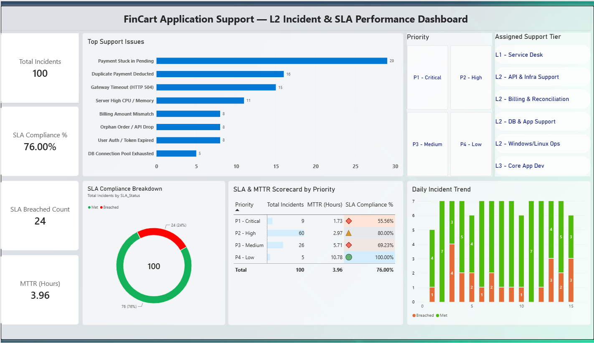
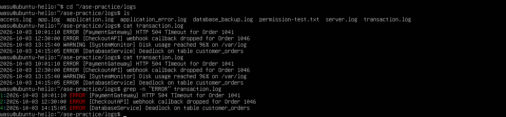
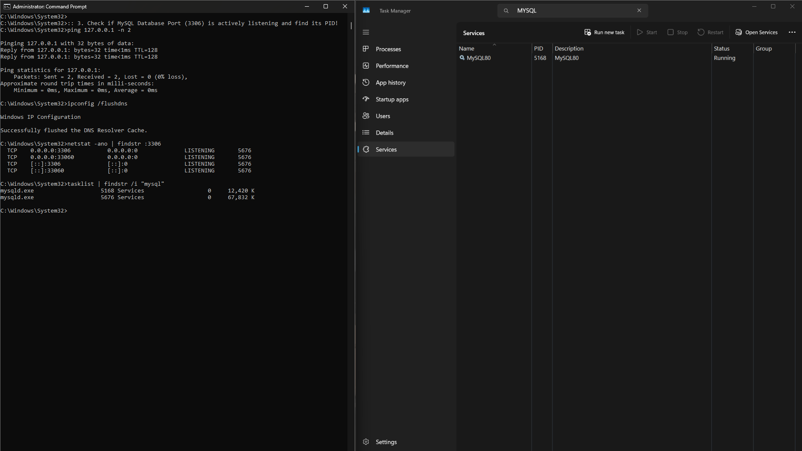

# FinCart L2 Application Support — Production Incident & SLA Triage Project

An end-to-end **Application Support Engineering (L2)** portfolio project simulating production incident management, database discrepancy troubleshooting, server log diagnostics, ITIL Root Cause Analysis (RCA), and SLA performance analytics.

---

## Tech Stack & Core Competencies
* **Database & Data Validation:** MySQL (`INNER JOIN`, `LEFT JOIN`, `GROUP BY`, `HAVING`, Safe `UPDATE` workarounds)
* **Linux & Windows Diagnostics:** Ubuntu Linux (`grep`, `tail`, `free -m`, `df -h`) & Windows Server (`Task Manager`, `netstat -ano`, `tasklist`, `ipconfig /flushdns`, `Event Viewer`)
* **Reporting & SLA Analytics:** Power BI (DAX Measures: MTTR, SLA Compliance %) & Microsoft Excel (`IF`, `COUNTIFS`, `AVERAGEIF`)
* **ITSM & Documentation:** ITIL Incident Management (P1–P4 SLA Matrix), Standard Operating Procedures (SOP), and Root Cause Analysis (RCA)

---

## 1. Power BI Incident & SLA Performance Dashboard
Analyzed 100 simulated production support tickets (`INC-2026001` to `INC-2026100`) across 8 issue categories:
* **Total Incidents:** 100 | **Overall SLA Compliance:** 76.00% | **SLA Breaches:** 24 | **Average MTTR:** 3.96 Hours
* **Key Insight:** *Payment Stuck in Pending* (29%) and *Duplicate Payment Deducted* (16%) accounted for **45% of total ticket volume**, driving the creation of automated SQL reconciliation scripts.

---

## 2. MySQL Database Reconciliation (`fincart_support`)
Built a 100-row relational dataset (`customer_orders` and `customer_payments`) and authored L2 diagnostic SQL scripts to resolve 4 critical production defects:
1. **Stuck Orders (6 cases):** Identified orders where `payment_status = 'SUCCESS'` but `order_status = 'PENDING'` and executed an `INNER JOIN` `UPDATE` workaround.
2. **Duplicate Deductions (3 cases):** Used `GROUP BY` and `HAVING COUNT() > 1` to isolate double-charged customers and calculate excess refund amounts.
3. **Orphan Orders (5 cases):** Used `LEFT JOIN ... WHERE payment_id IS NULL` to detect API drops between checkout and payment gateway.
4. **Billing Amount Mismatches (2 cases):** Detected checkout vs. gateway capture discrepancies.

---

## 3. Linux Log Analysis & Windows Server Troubleshooting
* **Ubuntu Linux CLI Triage:** Parsed `server.log` using `grep -n "ERROR"`, `grep -E "WARNING|ERROR"`, `tail`, `free -m`, and `df -h` to isolate database connection failures and memory warnings.
* **Windows Server & Port Diagnostics:** Verified localhost reachability (`ping`), cleared DNS cache (`ipconfig /flushdns`), traced active MySQL TCP port `3306` listener PIDs (`netstat -ano | findstr :3306`), and cross-verified parent/worker `mysqld.exe` processes (`PID 5168` & `5676`) in Task Manager.

### Ubuntu Linux Log Triage

### Windows Server & Port Diagnostics

---

## 4. Repository Files Included
* `1_schema_and_100_rows_data.sql` — MySQL schema & 100 rows of production-replica data
* `2_L2_diagnostic_and_fix_queries.sql` — L2 diagnostic & workaround SQL scripts
* `L2_Windows_and_Linux_Troubleshooting_SOP.md` — L1/L2 Server & Log Runbook
* `RCA_P1_Payment_Webhook_Outage.md` — P1 Post-Mortem & CAPA report
* `fincart_support_tickets_sla_tracker.xlsx` & `FinCart_SLA_Dashboard.pbix` — Excel & Power BI SLA analytics
